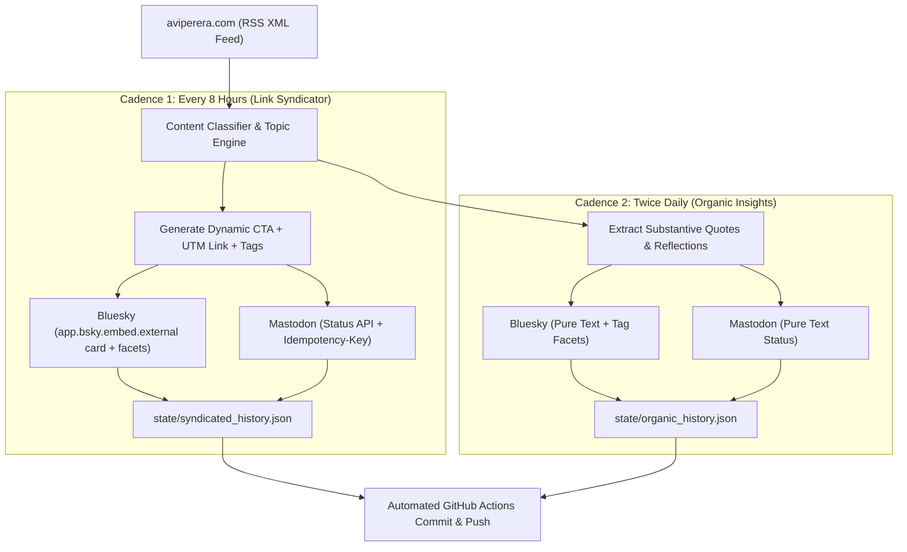

# 📢 Autonomous Multi-Platform Social Broadcaster & Funnel Engine

[](https://github.com/a-vip/social-broadcast-engine/actions/workflows/social-broadcast.yml)
[](https://github.com/a-vip/social-broadcast-engine/actions/workflows/organic-broadcast.yml)
[](LICENSE)
[](https://python.org)

An autonomous GitHub Actions content syndicator and organic audience growth engine for [aviperera.com](https://aviperera.com). It monitors new publications, classifies their topics, and orchestrates a dual-cadence broadcast strategy across **Bluesky** and **Mastodon**:

1. **8-Hour Link Syndicator**: Drives high-intent referral traffic using topic-tailored CTAs, rich external link cards, and UTM attribution parameters.
2. **Organic Insights Broadcaster**: Periodically extracts thought-provoking quotes and analytical statements as pure text posts (no links), keeping feeds engaging and boosting algorithmic reach.

---

## ⚡ Architecture & Dual Cadence



---

## 🎯 Topic-Aware Funnel & Tag Matrix

The engine analyzes each article's title, excerpt, and categories using `content_classifier.py` to match the exact subject area:

| Subject Domain | Example Keywords | Relevant Hashtags | Dynamic Call to Action (CTA) |
| :--- | :--- | :--- | :--- |
| **Defense & Autonomous Weapons** | *Switchblade, drones, military, LAWS, loitering munitions, warfare* | `#AutonomousWeapons` `#LAWS` `#DefenseTech` `#MilitaryAI` | *Explore the full operational breakdown & legal assessment:* |
| **AI Governance & Safety** | *Frontier AI, alignment, LLMs, algorithms, sovereign, ethics* | `#AIGovernance` `#AISafety` `#AIEthics` `#ArtificialIntelligence` | *Read the complete policy analysis & institutional framework:* |
| **International Law & Sovereignty** | *IHL, Geneva conventions, treaties, state liability, jurisdiction* | `#InternationalLaw` `#IHL` `#LegalFramework` `#GlobalGovernance` | *Read the complete legal breakdown & treaty analysis:* |
| **Software Architecture & Tech** | *Python, architecture, APIs, dashboards, React, GitHub* | `#SoftwareEngineering` `#TechArchitecture` `#OpenSource` | *Explore the technical architecture & implementation:* |
| **Research & Productivity** | *Obsidian, deep work, academic workflows, strategy, habits* | `#AcademicResearch` `#DeepWork` `#Productivity` | *Read the full essay and actionable takeaways:* |

---

## 🔐 GitHub Secrets Configuration

Add the following 4 secrets in repository settings (`Settings -> Secrets and variables -> Actions`):

| Secret Name | Description | Example / Instructions |
| :--- | :--- | :--- |
| `BSKY_IDENTIFIER` | Your Bluesky handle | `aviperera.bsky.social` |
| `BSKY_APP_PASSWORD` | App password from Bluesky | Bluesky Settings ➔ Privacy & Security ➔ App Passwords |
| `MASTODON_INSTANCE_URL` | Your Mastodon server URL | `https://mastodon.social` (or your chosen instance) |
| `MASTODON_ACCESS_TOKEN` | Mastodon Application Token | Mastodon Preferences ➔ Development ➔ New Application (`write:statuses` scope) |
| `COMMUNITY_WEBHOOK_URL` | *(Optional)* Discord / Slack Webhook | `https://discord.com/api/webhooks/...` |

---

## 🛡️ Reliability Guarantees

- **Immune to Hostinger WAF**: Ingests primary data via `https://aviperera.com/feed/` (RSS XML) with desktop browser headers, bypassing Hostinger Web Application Firewall blocks on GitHub Actions runner IPs.
- **Strict Byte-Offset Facets**: Bluesky links and hashtags are mapped with exact UTF-8 byte offsets for 100% clickable interactivity.
- **Character Limit Clamping**: Hard-enforced 295-character safe boundary on Bluesky (below the 300-grapheme hard limit) with intelligent title/hook truncation.
- **Idempotency Protection**: Mastodon requests include SHA-256 idempotency keys to eliminate duplicate postings during transient retries.
- **Per-Platform State Isolation**: If Bluesky succeeds but Mastodon times out, `state/syndicated_history.json` records individual platform success so future runs only retry the failed service.
- **Zero Third-Party Dependencies**: Built exclusively with Python standard libraries (`urllib`, `xml.etree`, `json`, `hashlib`), preventing `pip` dependency decay forever.

---

## 💻 Local Testing & CLI Simulation

```bash
# Preview what would be broadcast without sending to live networks:
python broadcast_engine.py --dry-run

# Preview organic quotes extraction:
python organic_broadcaster.py --dry-run

# Run full test suite:
python -m unittest discover tests
```

---

## 📄 License

MIT © [Avi Perera](https://aviperera.com)
