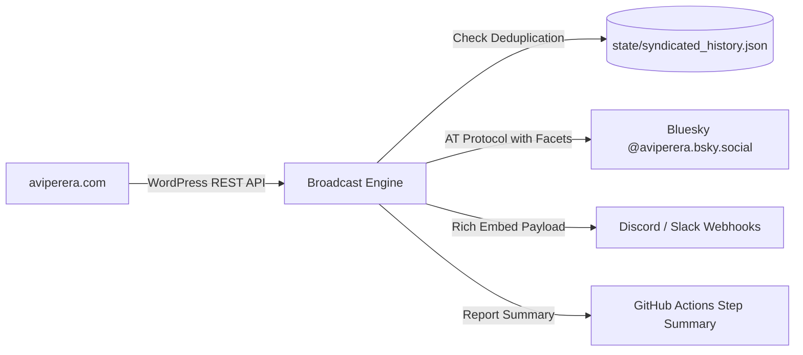

# 📢 Autonomous Multi-Platform Social Broadcaster

[](https://github.com/a-vip/social-broadcast-engine/actions/workflows/social-broadcast.yml)
[](LICENSE)
[](https://python.org)

An autonomous GitHub Actions content syndicator that automatically monitors [aviperera.com](https://aviperera.com) and broadcasts newly published research papers, AI governance essays, and defense dossiers to **Bluesky** (via the AT Protocol) and **Community Webhooks** (Discord, Telegram, Slack).

---

## ⚡ How It Works



1. **Autonomous Polling**: Runs every 4 hours via GitHub Actions.
2. **Deduplication Engine**: Uses `state/syndicated_history.json` to prevent re-posting existing publications.
3. **Smart Formatting**: Converts titles and links into rich social copy with hashtags (`#AIGovernance`, `#LAWS`, `#AutonomousWeapons`).
4. **Resilient Dry-Run**: Runs safely in dry-run preview mode until GitHub secrets are configured.

---

## 🔐 GitHub Secrets Configuration

Add these secrets in repository settings (`Settings -> Secrets and variables -> Actions`):

| Secret Name | Description | Example |
| :--- | :--- | :--- |
| `BSKY_IDENTIFIER` | Your Bluesky handle or email | `aviperera.bsky.social` |
| `BSKY_APP_PASSWORD` | App password from Bluesky settings | `xxxx-xxxx-xxxx-xxxx` |
| `COMMUNITY_WEBHOOK_URL` | (Optional) Discord or Slack Webhook URL | `https://discord.com/api/webhooks/...` |

> [!TIP]
> Always generate an **App Password** from `Bluesky Settings -> Privacy and Security -> App Passwords`, rather than using your primary account password.

---

## 💻 Local CLI

```bash
# Preview what would be broadcast without sending
python broadcast_engine.py --dry-run
```

---

## 📄 License

MIT © [Avi Perera](https://aviperera.com)
